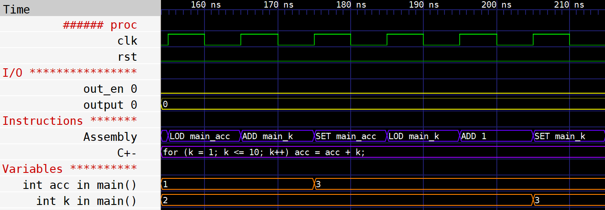

# A first program

From an empty folder to a simulated processor, assuming YANC is installed
and on the PATH (see [Installing YANC](install.md)) and Icarus Verilog is at
hand. The same program is written in C± and in C++; the package's
`example/` folder holds both.

## The program

`my_program.cmm`:

```c
#NUIOIN 1
#NUIOOU 1

void main()
{
    int acc = 0;
    int k;
    for (k = 1; k <= 10; k++) acc = acc + k;
    out(0, acc);            // writes 55 to output port 0
}
```

or `my_program.cpp`:

```cpp
#pragma yanc nuioin 1
#pragma yanc nuioou 1

int main() {
    int acc = 0;
    for (int k = 1; k <= 10; ++k) acc += k;
    out(0, acc);            // writes 55 to output port 0
    return 0;
}
```

The first lines set the processor: one input port and one output port. The
rest is the program; `out(0, acc)` puts `acc` on output port 0.

## Make the processor

```
yanc my_program.cmm
```

`yanc` compiles the program and builds the processor `my_program` in the
folder `my_program/`: its Verilog `my_program.v`, its memories, and a
testbench `my_program_tb.v` (see [The command line](command-line.md)). It
prints `SAPHO processor ready: my_program/my_program.v`.

## Simulate it

The testbench runs the processor and writes what it outputs to
`output_0.txt`. With Icarus, from the output folder (`SAPHO` being the
`SAPHO/` folder of the package):

```bat
cd my_program
iverilog -s my_program_tb -o sim.vvp -y %SAPHO% my_program_tb.v my_program.v
vvp sim.vvp
type output_0.txt
```

`-y` tells the simulator where to find the SAPHO modules the processor
uses.

`output_0.txt` holds `55`.

## Look at it run

The simulation also wrote the waveform `my_program_tb.vcd`. `gen_gtkw`
turns it into a view that shows, clock by clock, the source line being
executed, the assembly instruction, and every variable by name (a variable
written and never read is not in the processor, see below):

```bat
gen_gtkw my_program_tb.vcd my_program_tb.gtkw ..
gtkwave my_program_tb.vcd -a my_program_tb.gtkw
```

(`..` is the folder that holds the output folder; see
[Simulation](simulation.md).)



One turn of the loop, zoomed in: each clock runs one instruction; `acc`
takes its new value at `SET main_acc`, `k` at `SET main_k`. The C± line
stays the same, because all six instructions come from it.

## A program that reads its input

```c
#NUIOIN 1
#NUIOOU 1

void main()
{
    while (1)
    {
        int x = in(0);      // the next value of input port 0
        out(0, 3 * x + 1);
    }
}
```

Saved as `triple.cmm`, with a file `input_0.txt` beside it holding the
values to feed, one per line, `yanc triple.cmm` and the same simulation
write `3x + 1` for each of them to `output_0.txt`, as many as the
testbench's clocks reach (`yanc -c` sets how many). When the file runs out,
the port keeps its last value: with `1`, `2`, `10` in `input_0.txt`, the
output is `4`, `7`, `31`, and then `31` again until the simulation ends.

## A closer look: a hand-written square root

The `Sqrt` test of the repository (`Compilers/CMMComp/Tests/Sqrt/`) checks a
hand-written square root against the library's. Its two data files load
1000 inputs and their exact square roots straight into the data memory, and
the program writes nothing out: the result is read in the waveform, where
`e` shows the error of each version, input by input, next to the source
line being executed. Nothing reads `t` and `e`, and a variable never read
leaves the program; `#WAVE t, e` keeps them, to be seen in the waveform
(see [Directives](directives.md#waveform)).

```c
#NUIOIN 1
#NUIOOU 1

// square root by Newton-Raphson, from a first guess built on the exponent
float my_sqrt(float num)
{
    if (num == 0.0) return 0.0;

    int v = (((num << 1) >>> 24) + 22) >>> 1;         // get the exponent
        v = ((((v-22) << 23) + (1 << 22)) << 1) >> 1; // build the float

    float x; copy(v,x);                               // the same bits, as a float

    x = 0.5 * (x + num/x);   // 4 Newton-Raphson iterations
    x = 0.5 * (x + num/x);
    x = 0.5 * (x + num/x);
    x = 0.5 * (x + num/x);

    return x;
}

void main()
{
    float x[1000] "sqrt_x.txt";   // the inputs, loaded into data memory
    float a[1000] "sqrt_y.txt";   // their exact square roots
    float y, t, e;
    #WAVE t, e                    // never read: kept for the waveform

    int j = 0;
    while (j < 1000)              // the library's sqrt
    {
        y = sqrt(x[j]);
        t = a[j];
        e = t - y;                // its error
        j++;
    }

    j = 0;
    while (j < 1000)              // the hand-written one
    {
        y = my_sqrt(x[j]);
        t = a[j];
        e = t - y;                // its error
        j++;
    }
}
```

`my_sqrt` reads the float's exponent with integer shifts and builds a first
guess from it with `copy`, which moves bits between an `int` and a `float`
without converting (see [Floating point](floating-point.md)). The tests of
`Compilers/CMMComp/Tests/` and `Compilers/CPPComp/Tests/` hold many more
programs, one per feature of the two languages.
