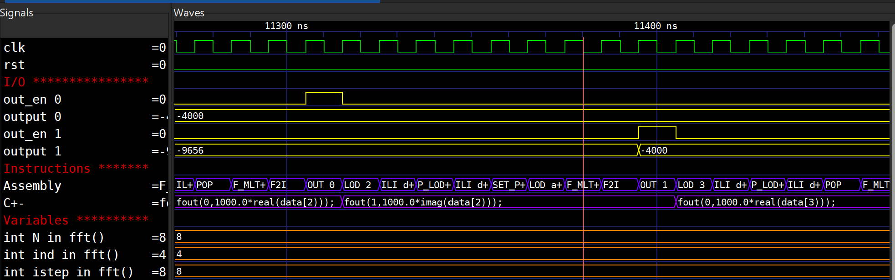

# Simulation and the waveform

`yanc` stops at the Verilog (see [The command line](command-line.md)). The
output folder then holds everything a simulator needs: the processor
`<name>.v`, its memories, and the testbench `<name>_tb.v`, which feeds each
input port from `input_N.txt` beside the source and writes what the program
outputs to `output_N.txt`. This page runs it with Icarus Verilog or
Verilator and opens the waveform in GTKWave.

## Simulating with Icarus

From the output folder, with `SAPHO` the `SAPHO/` folder that comes with
YANC (on Windows, in the MSYS2 UCRT64 terminal, written `/c/path/to/SAPHO`
for `C:\path\to\SAPHO`; see [Installing YANC](install.md)):

```sh
export SAPHO=/path/to/yanc/SAPHO
iverilog -s my_program_tb -o sim.vvp -y "$SAPHO" my_program_tb.v my_program.v
vvp sim.vvp -fst
cat output_0.txt
```

`-y "$SAPHO"` makes the simulator look in `SAPHO/` for each module it is
missing, in the file of the same name: `processor` in `processor.v`, and
from there `core.v`, `ula.v`, `addr_dec.v`, `instr_dec.v`, and `myFIFO.v`
or `myDCFIFO.v` when a project uses them. Listing the files instead works
too.

The testbench simulates as many clocks as `yanc -c` said (10000 by
default) at the clock of `yanc -f` (100 MHz by default), and writes the
waveform to `my_program_tb.fst`. The format comes from the simulator, not
from the name: `vvp -fst` writes FST, compressed, which GTKWave, AURORA and
`gen_gtkw` read; a `vvp` without `-fst` writes a text VCD under the same
name, which they read as well, 7 to 34 times the size in the measures of
issue #217.

**Run the simulation from the output folder.** The generated Verilog names
every file relative to it: the memories (`my_program_inst.mif`,
`my_program_data.mif`), the PC table, the outputs (`output_N.txt`,
`toma_k.txt`) and the waveform by their bare names, and the inputs
(`input_N.txt`, `cade_k.txt`) by the way from the output folder to the
source, `./input_0.txt` when the output folder is the default, the
source's own. No absolute path is written, so the folder can be moved or
copied to another machine along with the source, and a folder name with
accents or spaces costs nothing: the YANC tools work in UTF-8 on Windows,
Linux and macOS alike. To synthesize, give the synthesis tool the `.mif`
files in its project folder, or their full path in the `DFILE`/`IFILE`
parameters.

## What you see in GTKWave

Because the toolchain emits a side-table mapping each PC value to its
originating C± source line, GTKWave shows the executing C± line,
the assembly opcode, and every declared variable evolving in lockstep
with the simulated clock — not just raw bus toggles:



The example above is `proc_fft` mid-run: the C± track shows the
`fout(0, 1000.0*real(data[2]));` statement, the assembly track shows
the matching `LOD / F_MLT+ / F2I / OUT 0` sequence, and the
declared variables (`N`, `ind`, `istep`, `j`, `k`, `m`, `mmax`,
`sind`, `comp temp`) carry their live values.

## Simulating with Verilator

Verilator 5 compiles the same generated `<proc>_tb.v` directly — `--timing` understands the testbench's clock and `#` delays, so no separate C++ driver is needed:

```sh
# from the output folder, the one of my_program.cpp
verilator --binary --timing --trace-fst +define+YANC_TRACE --timescale 1ns/1ps \
          --top-module my_program_tb -Wno-lint -Wno-MULTIDRIVEN -Wno-BLKANDNBLK \
          -Wno-COMBDLY -Wno-STMTDLY -Wno-INFINITELOOP -Wno-UNOPTFLAT --Mdir vl \
          -y "$SAPHO" my_program_tb.v my_program.v
./vl/Vmy_program_tb     # runs the sim, writes my_program_tb.fst here
gtkwave my_program_tb.fst
```

On Windows, MSYS2's gcc 16 needs `-CFLAGS -D_GLIBCXX_ASSERTIONS` added to
the `verilator` line, or the link fails (see
[Installing YANC](install.md#to-simulate)); the scripts below add it
themselves.

`--trace-fst` writes the waveform as FST, and Verilator's FST writer needs
the LZ4 headers: on Windows the package `mingw-w64-ucrt-x86_64-lz4`, which
`Scripts/setup.sh` installs along with Verilator (see
[Installing YANC](install.md#to-simulate)).

`--timescale 1ns/1ps` gives the SAPHO modules the testbench's time unit:
the files `-y` finds are read on their own, so they do not inherit the
testbench's `` `timescale `` as files listed after it do, and Verilator
stops at the difference.

Verilator builds with GNU make, which refuses a build folder whose path has a
space. If the output folder's has one, point `--Mdir` somewhere without
spaces and still run the binary from the output folder.

**The one thing to remember:** `+define+YANC_TRACE` is what makes your variables, arrays, the PC→C± line table and the assembly opcode appear in the waveform. Icarus gets them for free (it predefines `__ICARUS__`); Verilator only compiles that visibility harness when you pass the define. The trace deliberately carries only the `<proc>`-level user signals — the CPU internals below each processor are fenced out with `/* verilator tracing_off */`. **In particular the stack-monitoring flags and the ULA rounding-error taps (`fl_max`, `fl_overflow`, `fl_top`, `pointeri`, `delta_int`, `delta_float`) are intentionally *not* in the Verilator waveform**: keeping them would force Verilator to evaluate the expensive real-valued ULA monitoring logic every cycle, which defeats the whole point of using Verilator (speed). Those debug signals remain available under the Icarus flow (`Scripts\single_proc.bat` / `multi_proc.bat`), where raw speed is not the goal.

## Formatting the waveform — `gen_gtkw` (optional)

After simulating with **either** Icarus or Verilator you have a raw `<tb>.fst`:
every signal, in scope order, unformatted. If you want the curated view
instead — the **input/output ports**, the **Assembly** and **C±** instruction
tracks (disassembled through their translate files), and the **internal
variables and arrays** grouped per processor — run **`gen_gtkw`** (it is in the
release's `bin/`), then open the waveform with it applied via `-a`. From the
Quick start's output folder:

```sh
gen_gtkw my_program_tb.fst my_program_tb.gtkw .
gtkwave my_program_tb.fst -a my_program_tb.gtkw
```

`gen_gtkw` reads only the waveform's **header** (the signal list), from an FST
or from a text VCD, which it tells apart by their first byte, classifies each
harness signal by name, and writes a formatted `.gtkw` save file: the right data
format / colour / alias per signal, the `trad_opcode.txt` / `src_lines.txt`
translators on the Assembly / C± tracks, `comp2gtkw.exe` on complex signals, and
one section per processor — any scope that owns both `valr2` and `linetabs` — so
the **same tool handles single- and multi-processor dumps**. Its third argument
says where each processor's translate files are: the output folder itself
for one processor (`.` from inside it, as in the Quick start), or the folder
that holds one output folder per processor, each named after its processor
(`proj/` for `proj/filtro/filtro.cmm` and `proj/fft/fft.cmm`, each written
beside its source).

Because only the header is needed, `gen_gtkw` reads an FST's hierarchy and
not its samples, so a project dump of several GB takes no longer to format
than a small one. With the **`+HEADER_ONLY`** plusarg the testbench dumps the
header, advances one tick, flushes and `$finish`es, for a view prepared before
the long run. **The runner scripts wire the sequence up** (simulation →
`gen_gtkw` → `gtkwave -a`), so they are the reference for using it in
practice. `gen_gtkw --vcd <in.fst>` writes the whole FST as text VCD on its
output, for a tool that reads only text; the regression reads the waveform
of each test that way. They also open GTKWave with `--dark`, and with
`--zoom-fit` (the whole trace in the window) and `--left-justify` when that
GTKWave lists them, as the nipscernlab build does (see
[Installing YANC](install.md#to-simulate)).

## Pre-wired scripts

Three scripts in the repository's `Scripts/` folder run the whole way, from a test program to GTKWave, with sensible defaults. Each has a
Windows (`.bat`) and a Linux (`.sh`) version, and picks the simulator from a
`--sim iverilog|verilator` flag (default Icarus):

```bat
Scripts\single_proc      .bat / .sh   one C± processor    (edit PROC / FNAM at the top)
Scripts\multi_proc       .bat / .sh   C± multi-proc project
Scripts\single_proc_cpp  .bat / .sh   one C++ processor   (front end: cppcomp)

  ... default (no flag)        -> Icarus Verilog (iverilog + vvp)
  ... --sim verilator          -> Verilator (--binary --timing, +define+YANC_TRACE)
  ... --no-view                -> (single_proc_cpp) run the pipeline, skip GTKWave
```

In the UCRT64 terminal on Windows, as on Linux, run
`Scripts/single_proc.sh` (or `Scripts/single_proc.sh --sim verilator`); on
Linux make them executable once (`chmod +x Scripts/*.sh`). The `.bat`
versions do the same from `cmd`.

**The C++ runner (`single_proc_cpp`)** feeds a `.cpp` program — the bundled
`Compilers/CPPComp/Tests/proc_cpp` demo — through `cppcomp` instead of
`cmmcomp`, then the *same* assemble / simulate / view back end. cppcomp now emits
the same files cmmcomp does (the `.asm`, `prog_log.txt`, the `pc_<proc>_mem.txt`
PC→source line table and `src_lines.txt`), so the waveform looks just like the C±
flow — **with one rule**: GTKWave only shows C++ variables that live at a **fixed
data-memory address**, because the dump snoops a *constant* write address
(`if (mem_addr_wr == X)`). That covers globals, the locals/params of
non-recursive functions, and `static` locals — int shown as a raw word, float
decoded, arrays element-by-element, exactly as in C±. Stack-frame locals of
recursive functions (no fixed address), pointers (an address, not a value) and
structs (a multi-word aggregate) are deliberately **not** traced. This mirrors
C±, which — for optimization reasons — only ever allocates fixed-address
variables anyway, so both flows show the same kind of thing.
