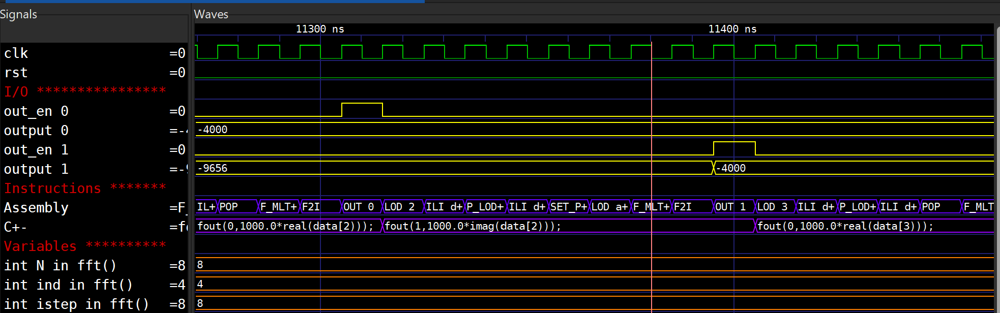

# Simulation and the waveform

`yanc` stops at the Verilog (see [The command line](command-line.md)). The
output folder then holds everything a simulator needs: the processor
`<name>.v`, its memories, and the testbench `<name>_tb.v`, which feeds each
input port from `input_N.txt` beside the source and writes what the program
outputs to `output_N.txt`. This page runs it with Icarus Verilog or
Verilator and opens the waveform in GTKWave.

## Simulating with Icarus

From the output folder, with `SAPHO` the `SAPHO/` folder that comes with
YANC:

```bat
cd my_program
iverilog -s my_program_tb -o sim.vvp my_program_tb.v my_program.v ^
         %SAPHO%\processor.v %SAPHO%\core.v %SAPHO%\ula.v %SAPHO%\addr_dec.v %SAPHO%\instr_dec.v
vvp sim.vvp
type output_0.txt
```

The testbench simulates as many clocks as `yanc -c` said (10000 by
default) at the clock of `yanc -f` (100 MHz by default), and writes the
waveform to `my_program_tb.vcd`.

## What you see in GTKWave

Because the toolchain emits a side-table mapping each PC value to its
originating C± source line, GTKWave shows the executing C± line,
the assembly opcode, and every declared variable evolving in lockstep
with the simulated clock — not just raw bus toggles:



The example above is `proc_fft` mid-run: the C± track shows the
`fout(0, 1000.0*real(data[2]));` statement, the assembly track shows
the matching `LOD / F_MLT+ / F2I / OUT 0` sequence, and the
declared variables (`N`, `ind`, `istep`, `j`, `k`, `m`, `mmax`,
`sind`, `comp temp`) carry their live values.

## Simulating with Verilator

Verilator 5 compiles the same generated `<proc>_tb.v` directly — `--timing` understands the testbench's clock and `#` delays, so no separate C++ driver is needed:

```bat
:: --- simulate with Verilator, from the output folder (my_program\) --------
cd my_program
verilator --binary --timing --trace +define+YANC_TRACE --top-module my_program_tb ^
          -Wno-lint -Wno-MULTIDRIVEN -Wno-BLKANDNBLK -Wno-COMBDLY -Wno-STMTDLY ^
          -Wno-INFINITELOOP -Wno-UNOPTFLAT --Mdir vl ^
          my_program_tb.v my_program.v ^
          %SAPHO%\processor.v %SAPHO%\core.v %SAPHO%\ula.v %SAPHO%\addr_dec.v %SAPHO%\instr_dec.v
vl\Vmy_program_tb.exe   :: runs the sim, writes my_program_tb.vcd here
gtkwave my_program_tb.vcd
```

**The one thing to remember:** `+define+YANC_TRACE` is what makes your variables, arrays, the PC→C± line table and the assembly opcode appear in the waveform. Icarus gets them for free (it predefines `__ICARUS__`); Verilator only compiles that visibility harness when you pass the define. For big multi-millisecond project dumps, use `--trace-fst` instead of `--trace` (compact FST; the file is still named `<tb>.vcd` and GTKWave detects the format). The trace deliberately carries only the `<proc>`-level user signals — the CPU internals below each processor are fenced out with `/* verilator tracing_off */`. **In particular the stack-monitoring flags and the ULA rounding-error taps (`fl_max`, `fl_full`, `pointeri`, `delta_int`, `delta_float`) are intentionally *not* in the Verilator VCD**: keeping them would force Verilator to evaluate the expensive real-valued ULA monitoring logic every cycle, which defeats the whole point of using Verilator (speed). Those debug signals remain available under the Icarus flow (`Scripts\single_proc.bat` / `multi_proc.bat`), where raw speed is not the goal.

## Formatting the waveform — `gen_gtkw` (optional)

After simulating with **either** Icarus or Verilator you have a raw `<tb>.vcd` /
`.fst`: every signal, in scope order, unformatted. If you want the curated view
instead — the **input/output ports**, the **Assembly** and **C±** instruction
tracks (disassembled through their translate files), and the **internal
variables and arrays** grouped per processor — run **`gen_gtkw`** (it is in the
release's `bin/`), then open the waveform with it applied via `-a`. From the
Quick start's output folder:

```bat
gen_gtkw my_program_tb.vcd my_program_tb.gtkw ..
gtkwave --dark --zoom-fit --left-justify my_program_tb.vcd -a my_program_tb.gtkw
```

`gen_gtkw` reads only the VCD **header** (the signal list), classifies each
harness signal by name, and writes a formatted `.gtkw` save file: the right data
format / colour / alias per signal, the `trad_opcode.txt` / `src_lines.txt`
translators on the Assembly / C± tracks, `comp2gtkw.exe` on complex signals, and
one section per processor — any scope that owns both `valr2` and `linetabs` — so
the **same tool handles single- and multi-processor dumps**. Its third argument
is the folder that holds each processor's output folder, where its translate
files are (`..` from inside `my_program/` in the Quick start, the folder that
holds `my_program/`).

Because only the header is needed, the big project FST dumps don't have to be
written in full first: run the sim once with the **`+HEADER_ONLY`** plusarg and
the testbench dumps the header, advances one tick, flushes and `$finish`es — a
tiny header VCD in milliseconds (Verilator's header FST is converted with
`fst2vcd -f`). **The runner scripts wire this whole sequence up
correctly** (header pass → `gen_gtkw` → `gtkwave -a`), so they are the reference
for using it in practice. `--zoom-fit` fits the whole trace to the window.

## Pre-wired scripts

Three scripts in the repository's `Scripts/` folder run the whole way, from a test program to GTKWave, with sensible defaults. Each has a
Windows (`.bat`) and a Linux (`.sh`) version, and picks the simulator from a
`--sim iverilog|verilator` flag (default Icarus):

```bat
Scripts\single_proc      .bat / .sh   one C± processor    (edit PROC / FNAM at the top)
Scripts\multi_proc       .bat / .sh   C± multi-proc project
Scripts\single_proc_cpp  .bat / .sh   one C++ processor   (front end: cppcomp)

  ... default (no flag)        -> Icarus Verilog (iverilog + vvp)
  ... --sim verilator          -> Verilator (--binary --timing, +define+YANC_TRACE)
  ... --no-view                -> (single_proc_cpp) run the pipeline, skip GTKWave
```

On Linux make them executable once (`chmod +x Scripts/*.sh`) and run
`Scripts/single_proc.sh` (or `Scripts/single_proc.sh --sim verilator`).

**The C++ runner (`single_proc_cpp`)** feeds a `.cpp` program — the bundled
`Compilers/CPPComp/Tests/proc_cpp` demo — through `cppcomp` instead of
`cmmcomp`, then the *same* assemble / simulate / view back end. cppcomp now emits
the same files cmmcomp does (the `.asm`, `prog_log.txt`, the `pc_<proc>_mem.txt`
PC→source line table and `src_lines.txt`), so the waveform looks just like the C±
flow — **with one rule**: GTKWave only shows C++ variables that live at a **fixed
data-memory address**, because the dump snoops a *constant* write address
(`if (mem_addr_wr == X)`). That covers globals, the locals/params of
non-recursive functions, and `static` locals — int shown as a raw word, float
decoded, arrays element-by-element, exactly as in C±. Stack-frame locals of
recursive functions (no fixed address), pointers (an address, not a value) and
structs (a multi-word aggregate) are deliberately **not** traced. This mirrors
C±, which — for optimization reasons — only ever allocates fixed-address
variables anyway, so both flows show the same kind of thing.
